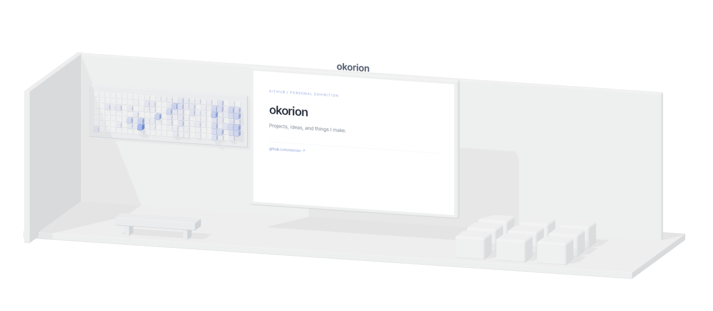
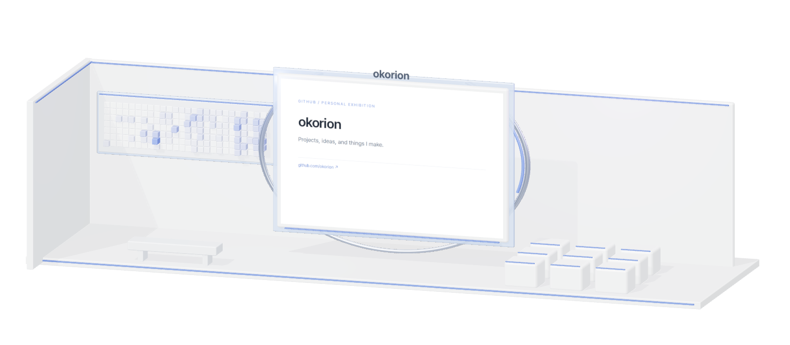
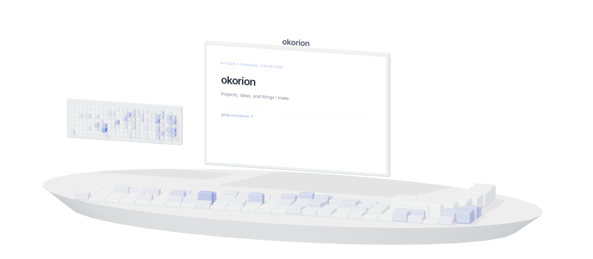
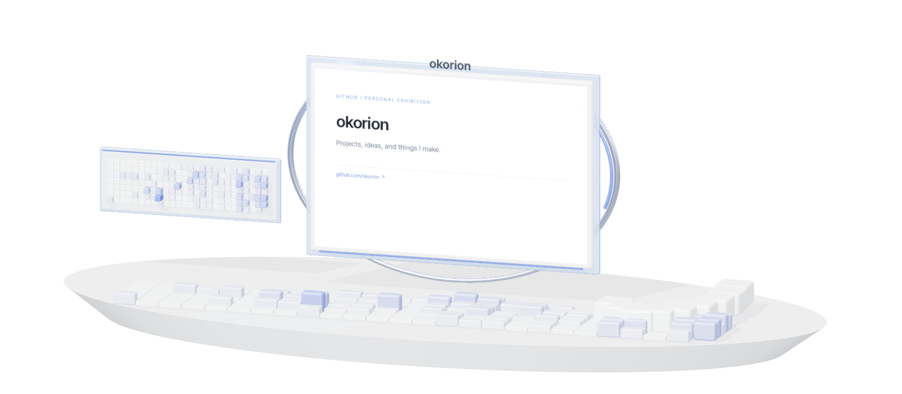
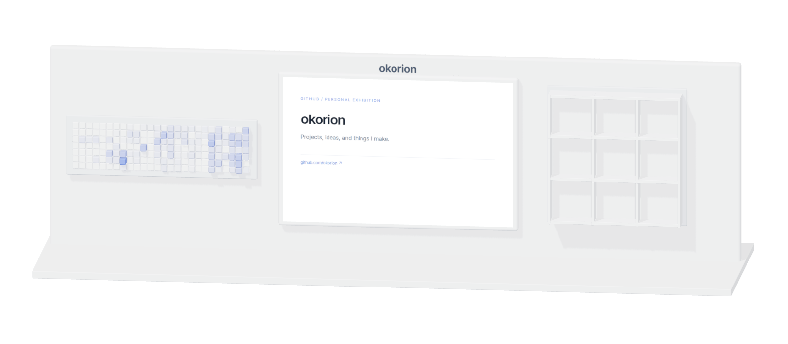
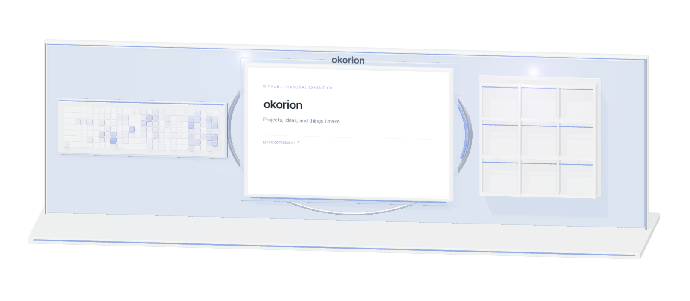
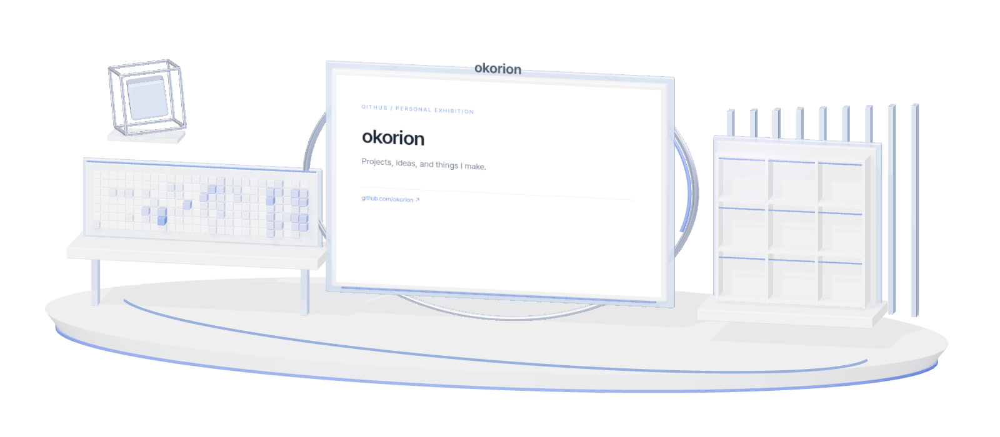
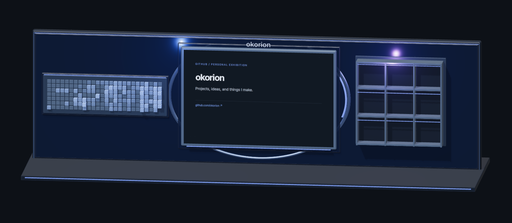
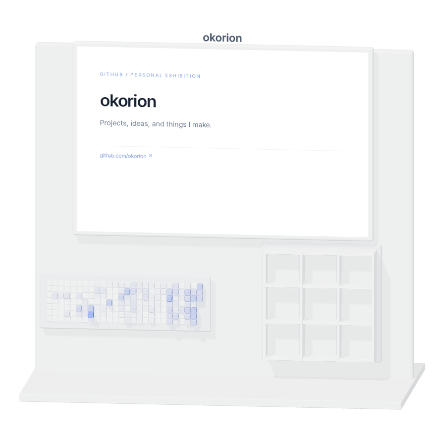
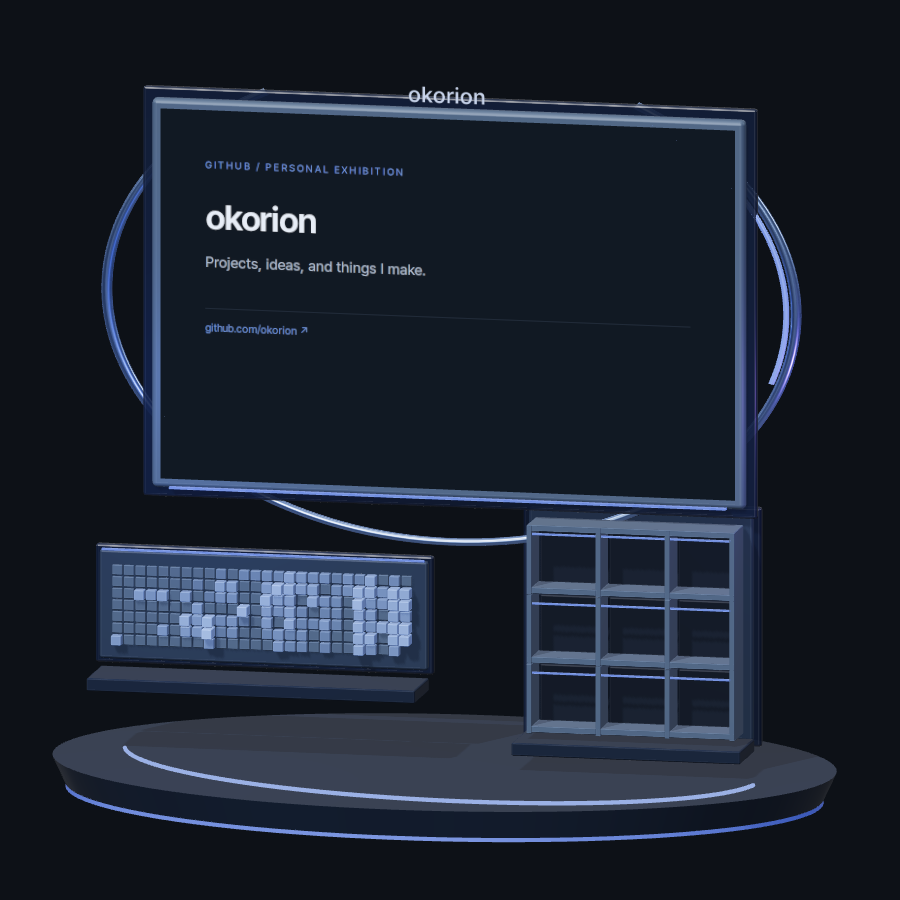

# Choose a design

These are generated examples. Each workflow run uses the repository owner's real
activity and visitor choices. Turn on `render_all` in Actions to refresh every
preview below for your own account. Simple and Advanced share exhibit positions
and camera angles; materials and lighting change.

| | Simple | Advanced |
|---|---|---|
| A · Gallery |  |  |
| B · Island |  |  |
| C · Wall |  |  |

## D · Pavilion

## Dark and mobile examples

[Change your selection](usage.md#settings) · [한국어 매뉴얼](../README.ko.md)
